  

  A template for building learning games as memory towns: every building is a concept, every lab is a place to get your hands on it.

Turn any subject into a small game you learn by playing: a pixel-art town where every house is
one concept and holds a lab to handle it. Built on recognised active-learning techniques
(retrieval practice, spacing, prediction, self-explanation, method of loci), not on points and
badges.

An AI coding agent does the work. You bring the subject and your material.

## How it works

| Layer | What it is | Where |
|---|---|---|
| **Knowledge base** | The course as data: concept map, learning path, lab designs, questions | `skills/knowledge-base/` writes `courses/<name>/` |
| **Engine** | The town, the rooms, the lab frame, the map, the questions | `engine/` |
| **Look** | Landscape, landmarks, buildings, music | `engine/src/art/` |

The knowledge base stands on its own: it is a course design a teacher can read, and the engine
is only one way to walk through it.

## Make your own

**In a Claude chat** (with code execution on): attach your material and write

> Clone https://github.com/AndreaCorvaglia0/mnemopolis, read AGENTS.md and follow it. I want a game to learn ‹subject›.

You get the game as an artifact you can open and share, and your course as a zip, to continue later.

**In a coding agent** (Claude Code or similar): press *Use this template*, open your copy and say
*"Read AGENTS.md. I want a course on ‹subject›. My material is in ‹folder›."* Your course lives in
`courses/‹name›/`; on every push a workflow validates it, builds it and, if GitHub Pages is on
(Settings → Pages → Source: GitHub Actions), publishes it.

By default the agent goes all the way to a playable game and shows you the map of the course on
the way. Say "ask me first" or "show me the map before building" if you want to steer it, and "light" or "curated" if you want less or more effort per concept (size and care are set independently).

`courses/chroma/` is a complete example (a short course on colour).

## Status

Early, and not yet play-tested with learners. The whole path works on the example course: design,
validation, build, publication. Feedback and issues are welcome.

Play the example, on a computer or a phone: https://andreacorvaglia0.github.io/mnemopolis/chroma/
See [docs/ROADMAP.md](docs/ROADMAP.md) and [docs/ARCHITECTURE.md](docs/ARCHITECTURE.md).

The research behind the method: [skills/knowledge-base/references/evidence.md](skills/knowledge-base/references/evidence.md).

MIT licence.
