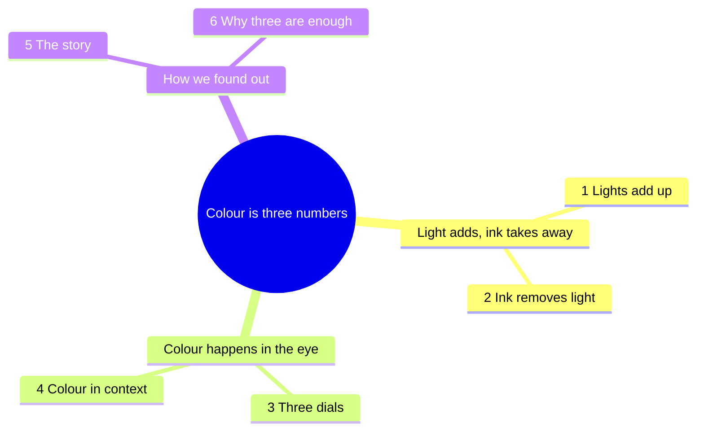
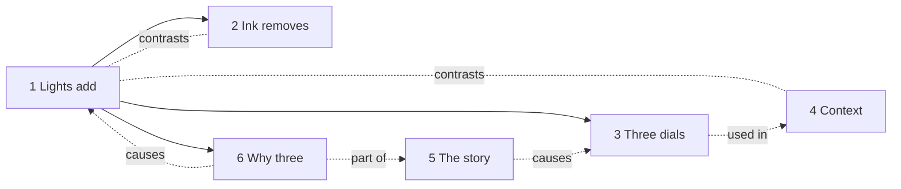

# Map and path: Chroma Town

## Big idea

> Colour is three numbers: three lights on a screen, three inks on paper, three signals in the eye.

## Concepts kept

| # | Concept | Type | Wrong belief before |
|---|---|---|---|
| 1 | Lights add up (additive mixing) | mechanism | Every mixture behaves like paint: more colours, darker |
| 2 | Ink takes light away (subtractive mixing) | process | Ink adds its colour to paper as a lamp adds light |
| 3 | Hue, saturation, lightness re-describe RGB | view | They are a different set of colours |
| 4 | Colour depends on its surround | cases | The eye measures colour like an instrument |
| 5 | How we found out | story | Three numbers are a computer convention |
| 6 | Why three numbers are enough (metamers) | deep | A device must emit light of each colour it shows |

## Left out

| Concept | Why |
|---|---|
| Colour temperature and white balance | Needs the spectrum of light sources: a second course |
| Colour spaces beyond sRGB, gamut, colour management | For practitioners; the learner's goals do not need them |
| Colour blindness | Deserves its own house; would follow from the deep dive |
| Pigment chemistry, structural colour | A different question (where colours come from) |
| Colour harmony and meaning | Opinion and culture, not mechanism |

## Mind map

## Links

Solid arrows: "is required by". The hub is concept 1: everything else leans on it, so it comes first and has two stations.

## Path

| Theme (cue) | # | Concept | Place | Requires | Call-back |
|---|---|---|---|---|---|
| Lamp Quarter (river, obelisk) | 1 | Additive mixing | Three Lamps House | | |
| | 2 | Subtractive mixing | Print Works | 1 | The same three lights, now taken away |
| Sight Hill (hill, statue) | 3 | Hue, saturation, lightness | Hue Tower | 1 | Every colour shown also as three lamp numbers |
| | 4 | Colour depends on context | Illusion Studio | | Lightness was a dial; here it misleads |
| Old Town (forest, stones) | 5 | How we found out | Colour Museum | | Maxwell's photograph is house 1 in 1861 |
| | 6 | Why three numbers are enough | Cone Cave | 1 | Three lamps are enough because the eye keeps three signals |

**Why this order.** Concept 1 needs nothing and already shows the big idea. It raises the question that concept 2 answers (why does paint get darker?). The second theme moves from the device to the observer. The story comes late on purpose: each plaque is recognised instead of learned, because the learner has already handled what it describes. The deep dive is last and optional: it explains why the first house works.
