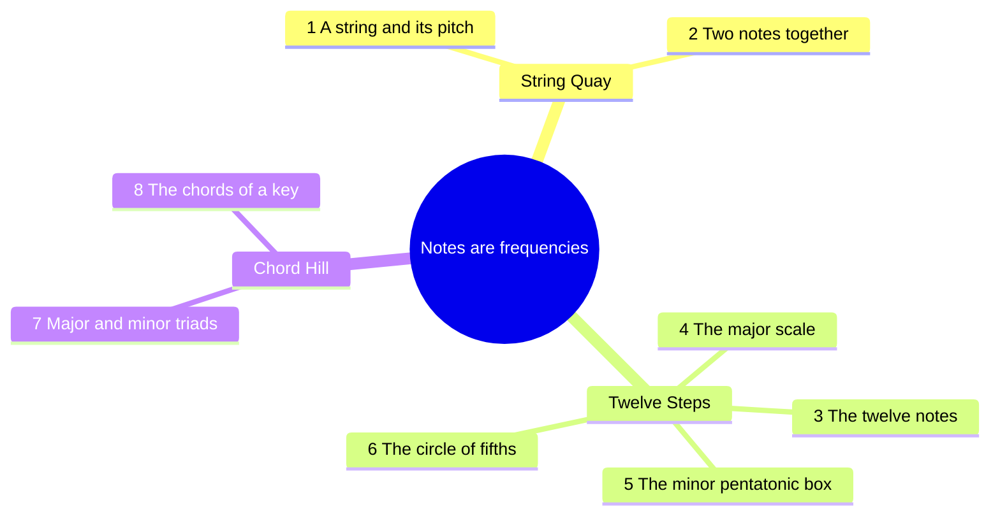
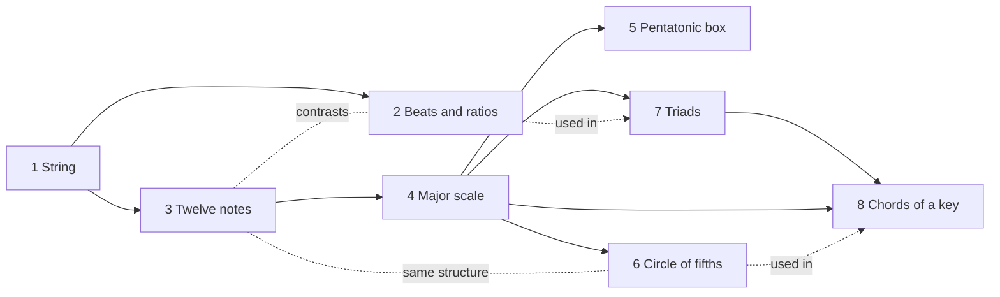

# Map and path: Port Octave

## Big idea

> Notes are frequencies: halving a string doubles its frequency, twelve equal steps fill that
> octave, and scales and chords are patterns of those steps on the fretboard.

It is a claim the learner can rebuild the course from: the string (frequency, the octave), the
ratios (why notes agree), the twelve steps, and the two patterns made of them (scale, chord).

## Ideas extracted (and what became of them)

From the syllabi (`syllabi.md`) and the physics sources, about fifty candidate ideas: frequency,
pitch, hertz, length, tension, mass, the octave, harmonics, nodes, natural harmonics, standing
waves, beats, interference, consonance, roughness, critical band, ratios 2:1 3:2 4:3 5:4, cents,
equal temperament, just intonation, Pythagorean comma, A4 = 440, standard tuning, the fifth-fret
rule, transposing an octave, note names, sharps and flats, enharmonics, half and whole steps,
the chromatic scale, the circle of notes, intervals and their names, interval inversion, the
major scale, scale degrees, key signatures, solfège, the natural minor, the relative minor,
modes, pentatonic scales, the blues scale, the circle of fifths, triads, the four triad
qualities, seventh chords, open chord shapes, barre chords, CAGED, inversions, voicings,
diatonic chords, Roman numerals, progressions, cadences, rhythm, meter, notation.

## Concepts kept

| # | Concept | Type | Core | Wrong belief before |
|---|---|---|---|---|
| 1 | A string and its pitch (`string`) | mechanism | yes | halving the string gives a note "a bit higher"; the octave is a different note |
| 2 | Two notes together: beats and ratios (`beats`) | mechanism | yes | two notes sit side by side; smooth or rough is only taste |
| 3 | The twelve notes (`twelve`) | view | yes | seven notes, evenly spaced; the next A is eight frets up |
| 4 | The major scale (`scale`) | mechanism | yes | a list of notes per key; C major is the normal one |
| 5 | The minor pentatonic box (`pentatonic`) | cases | extra | the box at fret 5 is "the" blues scale, fixed in A |
| 6 | The circle of fifths (`fifths`) | view | extra | a chart to memorise, unrelated to the twelve-note circle |
| 7 | Major and minor triads (`triads`) | parts | yes | six strings, six notes; major and minor are unrelated shapes |
| 8 | The chords of a key (`keys`) | choice | extra | chords are combined at random, or by teachers' rules |

## Left out

| Idea | Why |
|---|---|
| Notation (staff, clefs, rhythm, meter) | No guitar source surveyed requires it; it is a course of its own. "Written an octave higher" is named once |
| Intervals as a house of their own | No room in an hour (see `brief.md`, Core); the half and whole step live in `twelve`, the third and fifth in `triads`, and the name-the-interval game practises them |
| Modes, CAGED, barre chords, inversions, sevenths, extensions | Intermediate topics in every outline; CAGED is named upstairs in the Choir House as the next step |
| Cents, the Pythagorean comma, temperaments other than equal | The equal-tempered third against 5:4 shows the idea; cents add a unit without a new idea |
| Critical band, combination tones, inharmonicity | Correct and interesting, but the first is a refinement of "close harmonics beat", the others are not needed for a guitarist's question |
| The blues scale (with the ♭5) | One note more than the box; left to `further` |
| Standing-wave mathematics, wave speed in the string | The ratio (half the length, twice the frequency) is what the learner uses; the formula is in the source line of the lab |

## Mind map

## Links

Solid arrows are `requires`. Cross-theme links: `twelve` requires `string` (the octave is twelve
frets), `triads` require `scale`, `beats` is used in `triads` (the fifth of every chord is the 3:2),
and `twelve` contrasts with `beats` (equal steps give a nearly pure fifth and an impure third).

## The path

| Theme | # | Concept | Place | Type | Requires | Call-back |
|---|---|---|---|---|---|---|
| String Quay (shore, bell) | 1 | A string and its pitch | Luthier's House (Aldo) | mechanism | | |
| | 2 | Two notes together | Tuner's House (Ilse) | mechanism | string | the octave is also where harmonics line up |
| Twelve Steps (meadow, obelisk) | 3 | The twelve notes | Twelve-Hour Tower | view | string | the octave at half the string is fret 12 |
| | 4 | The major scale | The Step Ladder | mechanism | twelve | half steps are the steps of the scale |
| | 5 | Minor pentatonic box (extra) | Bluesman's House (Sam) | cases | scale | a pattern of distances, not a list |
| | 6 | Circle of fifths (extra) | Fifths Compass | view | scale | the sharp of the stencil; the 3:2 of the Tuner |
| Chord Hill (hill, arch) | 7 | Major and minor triads | Choir House (Cora) | parts | scale | the third and fifth of the scale; the 3:2 |
| | 8 | The chords of a key (extra) | Hall of Keys | choice | triads, scale | each chord is a triad of the Choir House |

**Why this order.** The first house assumes nothing and already shows the big idea at work: a
length becomes a frequency, and half the string is the same note again. The second asks the
question the first raises (why do the octave, and then the fifth, sound so well together) and
answers it with beats, which is also how guitarists tune. Only then come names: the twelve notes
divide the octave the learner has seen, and the major scale is a pattern of those steps. The triad
closes the core with what the learner's fingers already know (the open E chord), using the scale
for its third and the Tuner's 3:2 for its fifth. The extras sit where every source puts them,
after the scale; none is needed by a later core house.

## Active-learning plan (one line per concept)

| Concept | Prediction first | Hands on | The rule | Used elsewhere |
|---|---|---|---|---|
| string | half the string gives ×? | pluck, slide the finger, turn the peg | f doubles at half length; the 12th fret | upstairs: harmonics at 12, 7, 5 |
| beats | 3 Hz apart sounds like? | slide string B to unison, then far up | beats at the difference; smooth at shared harmonics | upstairs: the guitar's third beats; tune by ear |
| twelve | how many frets to the next A? | walk the dial and the string | 12 half steps, ×1.06 each; B–C and E–F | upstairs: the fifth-fret rule |
| scale | sharps of G major? | turn the stencil from C to G | W W H W W W H from any note | upstairs: the relative minor |
| pentatonic | where is the E minor box? | slide the box | the root on the low E names the key | the Bluesman's lock (G minor) |
| fifths | notes changed from C to G? | turn the key by fifths | one note per step, twelve steps round | I IV V are neighbours (Hall of Keys) |
| triads | names in an open E chord? | strum, lower the third | major 4+3, minor 3+4 | upstairs: five open shapes |
| keys | the chord on D in C major? | stack a chord on each note | I IV V major, ii iii vi minor | play I V vi IV |

## Locks

| House | Lock | Answer, read off | Inside |
|---|---|---|---|
| Luthier's | safe: "what the A string sings at the fret with two dots" | 220 (pluck) | the rule of 18 / 17.817; the harmonics station |
| Tuner's | safe: "where string B goes quiet again, far above 110" | 165 (wobble) | the guitar's fifth is 164.81; the station on the third |
| Twelve-Hour Tower | computer: "the note eight frets up from open A" | F (circle) | standard tuning in Hz; the fifth-fret station |
| Step Ladder | door: "the one note G major has and C major hasn't" | F sharp (stencil) | sharps added round the circle; the relative minor |
| Bluesman's | door: "tonight we play in G minor: the fret" | 3 (box) | G minor and B♭ major share the box |
| Choir House | computer: "the note that turns E major minor when dropped" | G sharp (stack) | where the third sits in each open shape; the five shapes |
