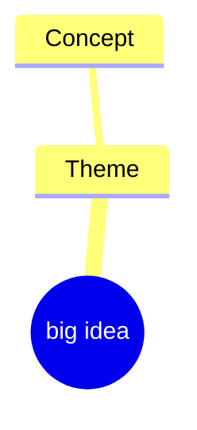
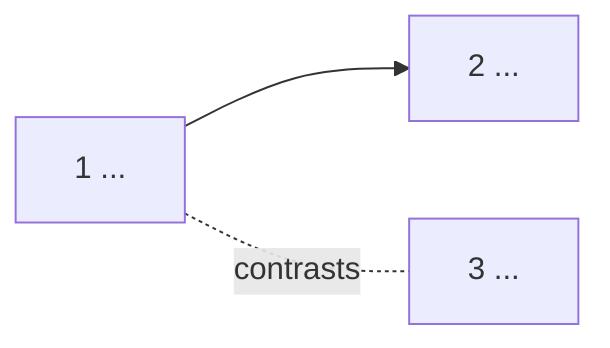

# Map and path: <course title>

## Big idea

> One claim, 28 words at most.

## Concepts kept

| # | Concept (a sentence with a verb) | Type | Wrong belief before |
|---|---|---|---|
| 1 | | | |

## Left out

| Concept | Why |
|---|---|
| | |

## Mind map

## Links

## Path

| Theme (cue) | # | Concept | Place | Requires | Call-back |
|---|---|---|---|---|---|
| | 1 | | | | |

**Why this order.**

## Checkpoint

- Shown to the user on:
- Changes asked:
