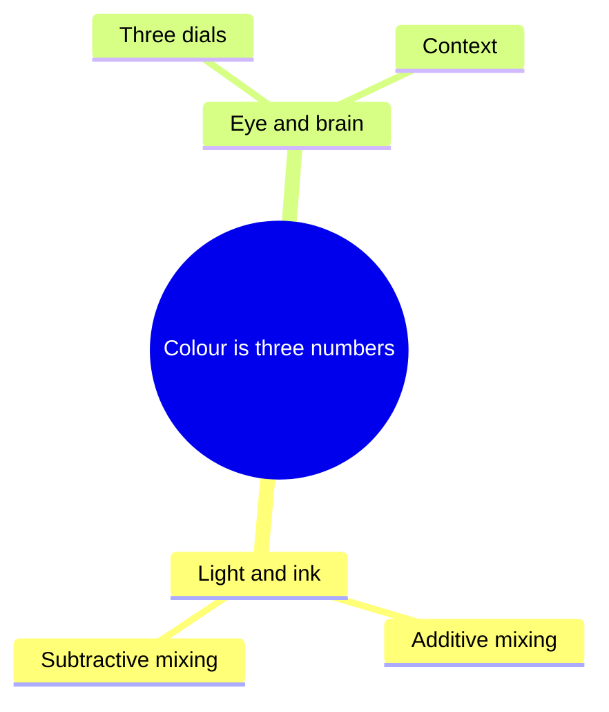

# Step 3. Map: from a pile of ideas to a connected few

## A. Extract

Go through the material and list every candidate idea: claims, mechanisms, procedures, terms,
distinctions, typical mistakes, examples. Do not judge yet. A standard subject gives 30 to 80.

## B. Find the big idea

One sentence, 28 words at most, from which the rest of the course follows.

- It is a **claim**, not a topic. "How colour works" is a topic. "Colour is three numbers: three
  lights on a screen, three inks on paper, three signals in the eye" is a claim.
- Test: could the learner, a month later, rebuild the outline of the course from it?
- If you cannot write it, you have not understood the subject well enough yet. Read more.

## C. Choose

Keep **6 to 12 concepts** (16 at most). A concept earns a place when:

- the learner would **miss it** when trying to do the goals in the brief;
- it can be stated as **one sentence with a verb** ("ink removes light");
- there is something to **see or handle**;
- it has a **typical wrong belief** attached.

Terms and details that only support a concept live inside it. Everything else goes to the
**left out** list, with a reason. That list is shown to the user.

## D. Type each concept

The type says what kind of knowledge it is, and so what the learner should do with it.

| `type` | The concept answers | The learner should |
|---|---|---|
| `mechanism` | What happens when I change this? | change a cause and watch the effect; break a part |
| `process` | What are the steps, in order? | run it step by step; skip or swap a step |
| `view` | How do I look at it? What do the numbers mean? | probe, measure, change coordinates |
| `parts` | What is it made of? What is each part called? | open the real thing and point |
| `choice` | Which one, when? What do I trade? | compare options on the same case |
| `cases` | Can I do it on a real one? | judge, sort or mark real examples |
| `story` | How did we get here? | walk a timeline (no lab) |
| `deep` | Why is it really so? (optional) | one demanding activity |

If a concept fits two types it is usually two concepts. If almost all have the same type, look
again: a course made only of mechanisms has forgotten the choices and the cases. Aim for at
least one `cases` or `choice` concept, because using knowledge is a goal in itself.

## E. Name the wrong belief

For each concept write what people believe **before**: the intuitive, wrong or incomplete idea.
Search for it if you do not know it ("misconceptions about ..."), or ask the user what they used
to think. If there truly is none, write what is merely unknown, and expect a plainer lab.

This single line is used three times: for the prediction question, for the moment of surprise in
the lab, and for the wrong options in the questions.

## F. Link

A list of concepts is not a map. Write the relations between them, using this vocabulary:

| `type` | Meaning | Example |
|---|---|---|
| `requires` | B cannot be understood without A | subtractive mixing requires additive mixing |
| `part-of` | A is a component of B | a cone signal is part of colour vision |
| `causes` | A produces B | three cone types cause three-number colour |
| `contrasts` | A and B are easily confused, or opposite | lights add, inks subtract |
| `same-structure` | A and B obey the same rule in different material | (the basis of an analogy) |
| `example-of` | A is a case of B | a pixel is an example of additive mixing |
| `used-in` | A is applied in B | halftone is used in printing |

Rules:

- Every concept has **at least one** relation. An orphan is either not part of this course or
  not understood yet.
- `requires` relations must not form a loop.
- Look for links **across** themes, not only inside them: they are what makes the knowledge one
  thing instead of chapters. Each of them is a planned call-back (step 4).
- The concepts with the most links are the hubs. They come early and get the most careful labs.

## G. Draw it

In `map.md`, draw the mind map with Mermaid so the user can see it:

````

````

And the dependencies as a graph (`flowchart LR`, one arrow per `requires`, dotted arrows for
other relations). Two small diagrams are better than one crowded one.

## Check before moving on

- [ ] The big idea is a claim, and every theme will be a part or a consequence of it.
- [ ] 6 to 12 concepts, each a sentence with a verb, each typed, each with a wrong belief.
- [ ] No orphans, no loops, at least one link across themes for every theme.
- [ ] The left-out list exists and gives reasons.
